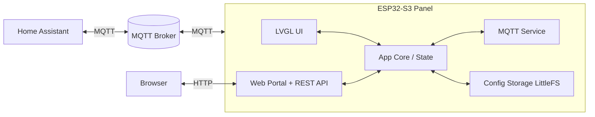

# HA Wall Panel — Project Plan

Wall-mounted touch remote for Home Assistant on the Panlee ZX3D95CE01S-TR-V12 (see [Board.md](Board.md)).
All panel ↔ HA communication runs over MQTT. Configuration and programming happen through an on-device web interface.

## 1. Goals

- 480×480 touch UI with multiple pages, switched by buttons or swipe (instant switch, no animation)
- Main page: 4 individually configurable tiles ("boxes")
- Thermostat tile: actual temperature + target temperature from an HA climate entity
- Uploadable background image
- Automatic display sleep, wake on touch
- System/info page with technical details, reboot, and author info
- Web interface for full configuration (modeled after `master-home-control`)

## 2. Architecture Overview



## 3. Tech Stack

| Area | Choice |
|---|---|
| Build | PlatformIO, Arduino framework, ESP32-S3 |
| Display / GUI | GC9503V RGB driver (from BSP) + LVGL |
| Touch | FT6336U / FT5x06 over I²C |
| Storage | LittleFS, JSON config (ArduinoJson), atomic write + backup |
| Networking | WiFi STA with AP fallback for first setup |
| MQTT | PubSubClient in its own FreeRTOS task |
| Web | Built-in `WebServer`, single-page HTML/CSS/JS, gzipped and embedded in firmware |
| OTA | Firmware upload via web interface (dual app partitions) |

## 4. Source Layout (proposed)

```
src/
  main.cpp
  app/     App core, state, config storage, power/sleep manager
  hw/      Display, touch, backlight, onboard temp/humidity sensor
  ui/      LVGL screens, page manager, tile widgets, gestures
  net/     WiFi manager, MQTT service, web portal
  web/     Generated embedded web assets (index_html.h)
web/       Web interface source (index.html)
tools/     Build scripts (embed web assets)
docs/      Board.md, Plan.md
```

## 5. Display UI

### Pages
- **Page manager**: ordered list of pages; navigate via on-screen buttons or horizontal swipe; no transition animation
- **Main page**: 2×2 grid of configurable tiles
- **Additional pages**: same tile grid, configurable number of pages
- **System page**: fixed, always last

### Tile types (initial set)
| Tile | Shows on tile | On tap |
|---|---|---|
| Thermostat | Actual + target temperature, mode | Detail page: +/- target, mode |
| Switch | On/off state | Detail page with switch |
| Light | On/off, brightness | Detail page: on/off, brightness, (color temp / color) |
| Cover / blind | Position, open/closed | Detail page: open / stop / close, position slider |
| Sensor | Value + unit (temp, humidity, power, …) | Optional detail page (min/max, last update) |
| Binary sensor | State (door, window, motion) with icon/color | — |
| Scene / script | Name + icon | Trigger (optionally with confirmation) |
| Button | Name + icon | Publish a configurable payload |
| Media player | Title, play state | Detail page: play/pause, next/prev, volume |
| Lock | Locked / unlocked | Detail page with lock/unlock |
| Fan | On/off, speed | Detail page: on/off, speed |
| Clock / date | Time and date (NTP) | — |
| Page link | Name + icon | Jump to another page |
| Empty | — | — |

Each tile: type, title, icon, bound HA entity / MQTT topics, tap behavior.

### Detail pages and confirmation
- Controlling tiles (switch, light, cover, lock, fan, …) do **not** act instantly on tap; tap opens a detail page with the actual controls
- Per tile option **"Require confirmation"**: before the command is sent, an "Are you sure?" dialog (Yes / Cancel) is shown
- Detail page shows live state from MQTT, has a back/close button, and auto-closes on sleep timeout
- Command is sent via MQTT; UI shows a pending state until the new state is confirmed by HA

### Background
- Image uploaded via web interface, stored in LittleFS, rendered behind tiles
- Defined format and size (480×480, e.g. JPG/PNG converted or validated)

### Color scheme
- Fully customizable via web interface, applied live on the panel (LVGL theme/styles)
- Colors: background, tile background (incl. opacity over background image), text, secondary text, accent, state on/off, warning/error, dialog
- Built-in presets (e.g. dark, light, high contrast) as starting points; custom schemes can be saved
- Optional per-tile color override (e.g. accent color of a single tile)

### Sleep / wake
- Inactivity timeout (configurable) → backlight off
- Touch wakes the display; the waking touch is not passed through as a tile action
- Optional dim stage before sleep

### System page
- WiFi: SSID, RSSI, IP, MAC, gateway, DNS, hostname
- MQTT: broker, connection state, client ID
- Device: firmware version, build date, uptime, free heap / PSRAM, flash size, chip info, reset reason, onboard sensor values
- Actions: reboot (with confirmation)
- Author: Philipp Albrecht · philipp@uisa.ch · www.uisa.ch

## 6. MQTT Integration

- Base topic per device, e.g. `panel/<device-id>/...`
- Availability topic with Last Will (online/offline)
- Per tile: state topic (subscribe) and command topic (publish)
- Thermostat: subscribe to current + target temperature, publish new target
- Publish panel telemetry (onboard temperature/humidity, RSSI, uptime)
- Optional: Home Assistant MQTT discovery for panel sensors and controls (backlight, reboot)
- HA side: automations or MQTT entities/bridges to map climate entities to topics

## 7. Web Interface

Modeled after `master-home-control`: single page, dark theme, tabbed navigation, JSON REST API, optional basic auth.

### Tabs
- **Status** — same information as the device system page
- **Pages & Tiles** — add/remove pages, configure each tile (type, title, icon, topics)
- **Appearance** — background image upload/preview, color scheme editor (color pickers, presets, live preview)
- **Display** — sleep timeout, brightness
- **WiFi** — scan, connect, hostname
- **MQTT** — broker, credentials, base topic, test connection
- **System** — OTA update, config export/import, factory reset, reboot

### API (sketch)
- `GET /api/status`
- `GET|PUT /api/config`
- `POST /api/background`
- `GET /api/wifi/scan`
- `POST /api/ota`
- `POST /api/reboot`

## 8. Configuration Model (sketch)

- `wifi`, `mqtt`, `display` (sleep, brightness), `web` (auth)
- `theme` → preset name + color values
- `pages[]` → `tiles[4]` → `{ type, title, icon, topics… }`
- Stored as JSON in LittleFS; changes applied live where possible, otherwise on reboot

## 9. Milestones

1. **Bring-up** — PlatformIO project, display + touch working with LVGL, backlight control
2. **Core** — config storage, WiFi (STA + AP fallback), system page
3. **UI framework** — page manager, buttons + swipe, 2×2 tile grid, sleep/wake
4. **MQTT** — service task, availability, thermostat tile end-to-end with HA
5. **Web interface** — status, WiFi/MQTT settings, tile configuration, OTA
6. **Background image** — upload, storage, rendering
7. **More tile types** — detail pages + confirmation dialog, then switch, light, cover, sensor, scene, etc.
8. **Polish** — HA discovery, config import/export, error handling, documentation

All milestones are implemented in firmware (compiles); hardware verification is pending.

## 10. Decisions (former open questions)

- **Framework:** Arduino + LovyanGFX `Panel_GC9503` / `Bus_RGB` (pins and timing from openHASP's TR-4848 profile)
- **Background:** any image format the browser can read; the browser crops/scales to 480×480 and uploads raw RGB565 (`/bg.bin`), loaded into PSRAM
- **Thermostat:** tile tap opens a detail page with −/+ and a "Set" button
- **Pages:** up to 10 configurable pages with exactly 4 tiles each, plus the fixed system page
- **Topics:** configured manually per tile; the panel itself is announced via HA MQTT discovery

## 11. Home Assistant Integration

The panel works with plain MQTT topics, so any HA setup that bridges entities to topics works. Recommended:

- **State → panel:** enable [`mqtt_statestream`](https://www.home-assistant.io/integrations/mqtt_statestream/) for the used entities, e.g.
  `homeassistant/climate/living_room/current_temperature`, `.../temperature`, `homeassistant/light/kitchen/state`, `.../brightness`.
  Quoted JSON strings from statestream are handled by the panel.
- **Panel → HA:** one automation per command topic (trigger: MQTT topic, action: service call with `{{ trigger.payload }}`), e.g.
  `panel/kitchen/light/set` → `light.turn_on`/`turn_off`, `panel/living/climate/set` → `climate.set_temperature`.
- **Panel device:** with discovery enabled, HA creates a device with WiFi signal, uptime, display state, brightness, reboot and wake.

### Panel topics

| Topic | Direction | Payload |
|---|---|---|
| `<base>/status` | panel → HA | `online` / `offline` (retained, LWT) |
| `<base>/telemetry` | panel → HA | JSON: rssi, ip, uptime, heap, psram, brightness, display, page |
| `<base>/cmd/reboot` | HA → panel | any |
| `<base>/cmd/wake`, `<base>/cmd/sleep` | HA → panel | any |
| `<base>/cmd/brightness` | HA → panel | 10–255 |
| `<base>/cmd/page` | HA → panel | page number (1-based) |
| `<base>/cmd/message` | HA → panel | plain text, or JSON `{title, text, level: info\|warning\|error\|alarm, buttons: none\|ok\|yes_no\|ok_cancel, wake, timeout, id}` |
| `<base>/message/response` | panel → HA | JSON `{id, title, answer}`; answer: yes, no, ok, cancel, dismissed, timeout, replaced |

### Fixed command payloads

| Tile | Command topic receives |
|---|---|
| Cover | `OPEN`, `STOP`, `CLOSE`; position command topic receives 0–100 |
| Lock | `LOCK`, `UNLOCK` |
| Media player | `PLAY_PAUSE`, `NEXT`, `PREVIOUS`; volume command topic receives 0–100 |
| Switch / light / fan | configured `payloadOn` / `payloadOff`; brightness/speed topic receives the slider value |
| Thermostat | target temperature as number |
| Scene / button | configured payload |

## 12. Build

- `~/.platformio/penv/bin/pio run -t upload -t monitor`
- `web/index.html` is gzipped into `src/web/index_html.h` by `tools/embed_web.py` on every build
- Optional `include/secrets.h` (see `include/secrets.example.h`) presets WiFi/MQTT credentials
- Without WiFi credentials the panel opens the AP `HA-Panel-<id>`; its password is shown on the system page
